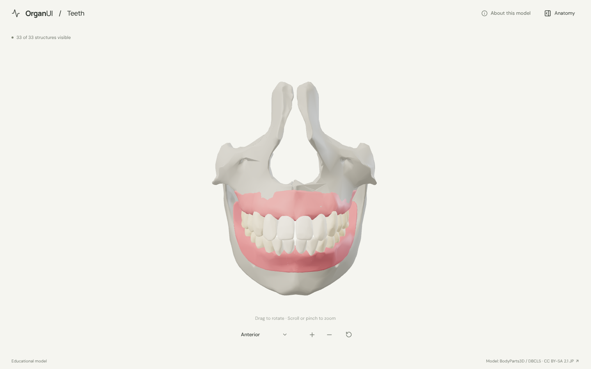
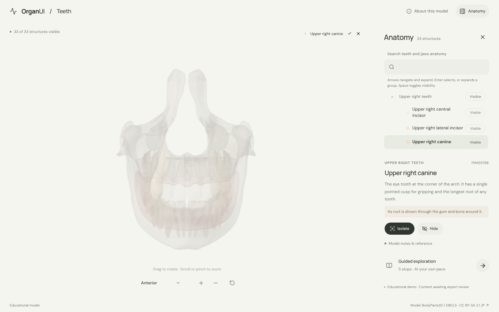
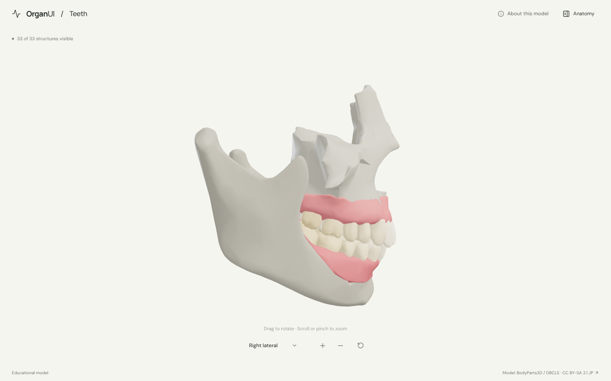
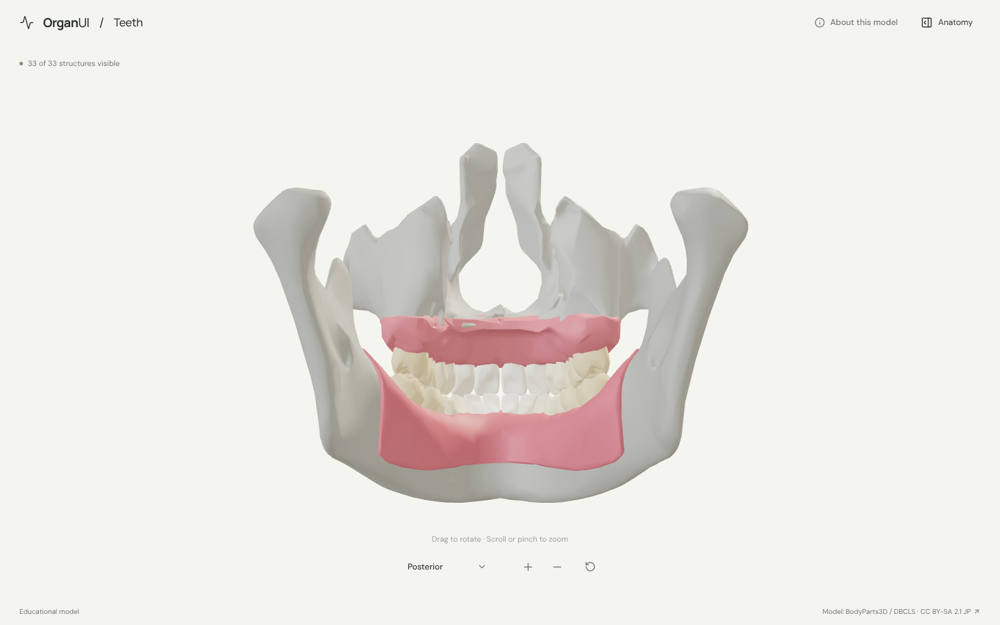
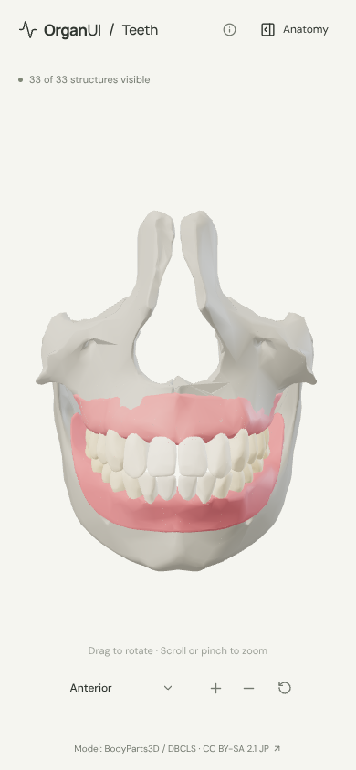

# OrganUI Teeth

A minimal, standalone, open-source explorer of the adult teeth, gums and jaws, built with React, TypeScript, Three.js, React Three Fiber, Vite, and Bun. It shares its interaction design and code with [OrganUI Heart](https://github.com/organui/heart-3d).

**Status:** working local demo. Thirty-three selectable structures from a real, openly licensed model, responsive layouts, and checked desktop/mobile interactions. Public deployment and clinical anatomy review have not been completed.



## Run locally

Install [Bun](https://bun.sh/) **1.4.2 or newer**, then:

```sh
git clone https://github.com/organui/teeth-3d.git
cd teeth-3d
bun install --frozen-lockfile
bun run dev
```

Open **http://127.0.0.1:5173**. No environment variables, accounts, API keys, sibling repositories, model downloads, or external font services are needed after dependency installation. The ready-to-use 1.5 MB GLB is in `public/models/`.

```sh
bun run typecheck       # TypeScript checks, including conversion scripts
bun run test            # Unit tests for selection emphasis, picking, ownership, and the anatomy-tree adapter
bun run verify:model    # Check the GLB hash, source IDs, element lists, and valid geometry
bun run build           # Typecheck and create dist/
bun run preview         # Serve the production build at http://127.0.0.1:4173
bun run format:check    # Check formatting
```

The app is static and uses relative build paths. No deployment has been performed.

## Explore

- The closed jaws open from the front, with all 28 teeth, both gums, the two maxillae and the mandible. Open **Anatomy** in the header to browse the teeth by quadrant (upper right, upper left, lower left, lower right), the gums and the jaw bones.
- Drag to rotate; scroll or pinch to zoom. The view menu has anterior, right lateral and posterior presets. Manual rotation changes its label to **Custom view**; zooming and selecting keep the view name.
- Select a mesh or use the anatomy tree (the OrganUI registry `anatomy-tree` component, see [registry integration](docs/REGISTRY_INTEGRATION.md)). The selected structure glows in its own colour and everything else is ghosted, so a tooth's root shows through the gum and bone around it.
- Each tooth's model notes give its Universal (1–32) and FDI (11–48) number.
- Isolate a structure, hide it, or restore all. **Reset explorer** restores the anterior camera, visibility, selection, tree state and tour.
- Follow five guided stops: the two arches, the canine's long root, the molars, the gums, and the mandible from behind.
- Keyboard: Tab/Enter for controls, arrow keys to rotate the focused model, `+`/`-` to zoom, Escape closes the panel and returns focus to its toggle.

<details>
<summary>Selection, lateral, posterior and mobile screenshots</summary>









</details>

## Model, credits, and license

> BodyParts3D / Anatomography, © The Database Center for Life Science (DBCLS), licensed under Creative Commons Attribution-Share Alike 2.1 Japan. Adapted by OrganUI.

The model is a curated subset of **BodyParts3D / Anatomography 4.3**: 33 source meshes, one per structure. The model data and screenshots of it are under **[CC BY-SA 2.1 Japan](https://creativecommons.org/licenses/by-sa/2.1/jp/deed.en)**, separately from this repository's **MIT code license**. Meshes come from a checksum-pinned public mirror and are cross-checked against the official 4.3 concept table. Read [model provenance](docs/MODEL_PROVENANCE.md), [asset attribution](public/models/ATTRIBUTION.md) and the [manifest](public/models/manifest.json).

Descriptions summarise the [Wikipedia article on human teeth](https://en.wikipedia.org/wiki/Human_tooth) and general dental anatomy; the sandbox this was built in could not reach that site, so the link itself was not re-checked. **Expert anatomical review is pending.** This is an educational interface demonstration, not a diagnostic or clinical tool.

Known limitations:

- The source has no third molars (wisdom teeth) and no primary (baby) teeth, so the model shows 28 permanent teeth.
- Each tooth is one closed surface: enamel, dentine, pulp, cementum and the periodontal ligament are not separated. Tooth sockets are not cut into the bone, so roots and bone overlap.
- The jaws are fixed in a closed bite. The rest of the skull, the temporomandibular joints, the palate's soft tissue, tongue, lips, jaw muscles, nerves and vessels are omitted. Colours are illustrative.
- Browser checks used headless Chromium with software WebGL at desktop and phone viewport sizes, not physical devices or a screen-reader audit.

## License

Original application code: [MIT](LICENSE). Anatomy model, derived model images, fonts, and icons retain their separately documented licenses.

Part of [OrganUI](https://github.com/organui).
